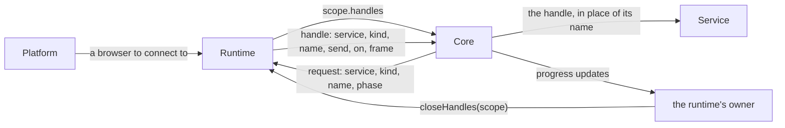

# Runtime Integration

This guide is for building other runtimes for MicroQL: a hosted automation service, on Cloudflare Workers or otherwise. It covers the spec a runtime must satisfy, and what decisions a runtime can and should make about state isolation and persistence.

## Core, runtime and platform

Three parties take part in running a Query, and each owns different things:

| Party | Is | Owns |
|---|---|---|
| **Core** | `compile`, `plan` and `execute`, imported as `microql/core` | Query interpretation: references, chains, `each`, retries, timeouts, error handling, scheduling, and which results to reuse |
| **Runtime** | one object for the whole process, usually extending MicroQL's `Runtime`, which gives each Query the [scope](#scopes) it runs in | how state is scoped: its services, their config and their [instances](#service-instances); the [Cache](#the-cache) and [Run States](#storage); and `env`, the environment's utilities, such as output |
| **Platform** | whatever calls core: a node script, a server, an editor | [Runs](#runs): which scope each runs in, and so which [Run State](#storage); where results are shown, and when stores are cleared |

**Core is kept free from environment dependencies: the file system, the network and so on.** A runtime provides these, through the scope it gives a Query: core makes every service call through the scope, and each service instance receives its `env`. MicroQL ships `Runtime`, the base a runtime extends, and one runtime, the **node runtime**, as the reference implementation. Any object that gives core a [scope](#scopes) is a runtime.

The platform is yours. [A suggested architecture](#a-suggested-architecture) at the end shows one way to build one, but MicroQL requires none of it.

## Scopes

**Scoping is the runtime's.** A scope is what the runtime keys a Query's state by, such as `{tenantId, runId}`, described by its scope schema, a zodly document; and it is what the runtime gives core to run the Query in, `runtime.scopeOf(scope)`. Core runs a Query in whatever scope it's given, and never knows how anything in it is keyed.

| Member | Is |
|---|---|
| `services.get(name)` | the service a key names, synchronously; compile looks up each key's service here. Every scope has `util` unless the runtime registers another service under that name |
| `env` | the environment's utilities, which debug output uses and each service instance receives ([The runtime API](#the-runtime-api)) |
| `handles[kind](request)` | the handle a call names, a resource outside the Query of a kind the runtime offers, such as a browser session ([Handles](#handles)). Services never see it |
| `call(key, fields)` | a service call's result. Core makes every call through it, with the key's fields, `{method, service, resource, confined}`, and the call's resolved fields |
| `cache` | the [entry store](#entry-stores) whose entries outlive a Run: the [Cache](#the-cache) |
| `run` | the entry store of the Run's results: its [Run State](#runs). Only a scope with every run key has one: a scope without, which `plan()` and `compile()` are content with, can't be executed |

**A runtime's run keys are the fields that name a Run**, such as `['runId']`; the rest of a scope outlives any one Run. `Runtime` keeps services, their config and the Cache by the scope without its run fields, and Run States and service instances by the whole scope, so each Run has its own:

| Runtime | Scope schema | Run scope | Services, config, Cache by | Run States, instances by |
|---|---|---|---|---|
| a platform's, by tenant | `{tenantId, runId}` | `['runId']` | `{tenantId}` | `{tenantId, runId}` |
| the node runtime | `{runId}` | `['runId']` | `{}` | `{runId}` |

A runtime with no run keys keeps everything by the whole scope. One that keys some other way overrides `scopeOf`.

## Entry points

| Import | Resolves to | Is |
|---|---|---|
| `microql` | `index.js` | core with the node runtime wired in. `query()`, `plan()` and `compile()` take a Query's `services`, and `query()` its `config`, and file them for every Run before going on; `query()` runs a Run of its own, whose Run State and instances it releases once done, unless you name one with `runId`. Also exports `NodeRuntime`, `nodeRuntime`, `fileStore` and `fileStores`. |
| `microql/core` | `core.js` | core alone, with no runtime of its own. `compile` refuses a Query without a `scope`, and `execute` a scope without a Run State (`scope.run`). A lint rule keeps node built-ins out of every core file, and the runtime out of the engine (`src/query`, `src/execute`, `src/types`). |

MicroQL has an internal compile step that turns a Query into a plan - an internal memory representation which is also serializeable. "compile" does not infer any sort of language transpilation: MicroQL is just JavaScript. A plan's types are zod schemas, which [zodex](https://www.npmjs.com/package/zodex) serializes; zodex 4.0.1 drops a format written as a check, such as zodly's `['string', 'email']` (see zodly's comparison with zodex).

Both export:

| Export | Is |
|---|---|
| `query(config, options)` | compile, execute, select |
| `compile(config)` | the Query as a plain tree of phases and calls; throws on compile-time errors |
| `execute(compiled, options)` | run a compiled Query; returns each executed phase's result |
| `plan(query, {trigger})` | everything an editor needs, without running anything |
| `applySelection(results, select)` | what `select` names |
| `addressToPath(plan, address)`, `pathToAddress(plan, path)` | [Service Call Addresses](#service-call-addresses) ↔ JSON paths |
| `memoryStore()` | an [entry store](#entry-stores) in memory |
| `scopedStores(storeOf)`, `memoryStores()` | entry stores by scope, which a runtime keeps the Cache and Run States in ([Entry stores](#entry-stores)) |
| `Runtime` | the base a runtime extends: its services, their config and instances, its stores, and the scopes it gives Queries ([The runtime API](#the-runtime-api)) |
| `ServiceRegistry`, `ConfigRegistry` | a runtime's services and their instances, and its config, by scope and name; `Runtime` makes one of each, and a runtime that keeps config elsewhere extends `ConfigRegistry` ([Config](#config)) |
| `configSchemaOf(declaration)` | the zod schema of a service's config declaration, `oauth` types included ([Config](#config)) |
| `serviceSmokeTests(service, {env, config})` | a table of tests checking a service against the service spec ([Service Development Guide § Testing services](service-guide.md#testing-services)) |
| `util` | the built-in service |
| `defineService(serviceDefinition)` | a service from a service definition, resources mapped to service calls; see the [Service Development Guide](service-guide.md#writing-a-service-with-defineservice) |
| `parseSchema(descriptor)` | the zod schema a [zodly](validation.md#schema-syntax) descriptor describes, for a service that hands schemas to a library |
| `errorSchema`, `isErrorData`, `toErrorData`, `fromErrorData` | [errors as data](#errors-as-data) |
| `format(value, options)` | a value as text, the same on every runtime |

## Storage

### Entry stores

**An entry store is a dumb key-value store.** Core decides the keys and the entries; the store decides only where they live. Keys are pairs of strings, a [form hash](#forms) and an input hash: the hash of every value a call reads on one execution — its own resolved fields, and, for a call that holds other calls, what those read from outside it (an enclosing iteration's item, an enclosing `catch`'s error, a phase). The form says where each value comes from; the input hash says what it was. So a form holds one entry per distinct input, and several inside an iteration.

Core calls three async methods, so a store may live anywhere: in memory, on disk, in a database, in KV.

```javascript
{
  get(form, input),         // the entry, or undefined
  set(form, input, entry),
  list(form)                // every entry for a form
}
```

To build one, implement those three methods over anything that stores JSON. Core never deletes entries; clearing a store is its owner's business. Both stores MicroQL ships, `memoryStore()` and the node runtime's `fileStore(dir)`, also offer `clear(form)` to empty one form, or `clear()` to empty all of them.

**A runtime keeps entry stores by [scope](#scopes)**, so no two scopes ever share an entry: `get(scope, form, input)`, `set(scope, form, input, entry)`, `list(scope, form)`. `scopedStores(storeOf)` makes them from a store per scope, made by `storeOf(scope)` on the scope's first use; `memoryStores()` keeps them in memory, and the node runtime's `fileStores(dir)` keeps a `fileStore` per scope, in a directory named by the scope's hash. Both offer `clear(scope, form)`, `clear(scope)` and `clear()`.

**The Cache and Run States are both kept this way, by different scopes.** The Cache is kept by the scope without its run fields, so its entries outlive a Run, and two tenants making an identical call, with credentials of their own, never share one. Run States are kept by the whole scope: each Run's own, and running again in the same scope resumes it.

### Two stores, two owners

| Store | Holds results for | Supplied by | Passed as |
|---|---|---|---|
| **Run State** | one [Run](#runs) | the runtime, by the Run's scope | `scope.run`, from `runtime.runStates` |
| **Cache** | every Run, for calls with `cache` set | the runtime, by the scope without its run fields | `scope.cache`, from `runtime.cache` |

**A Run State entry** holds `address`, `input`, `inputs` (the resolved input fields), `reads` (for a call that holds others, what they read from outside it, by reference), `status` (`done` or `failed`), `output` or `error` (`{message, attempts, at}`), `startedAt` and `duration`. Core reuses only `done` entries, so a failed call runs again on resume. A failure a `catch` handled is the holding call's output, as [error data](#errors-as-data), so it is stored and reused like any other result.

### The Cache

Core reuses a Cache entry while it is younger than the call's ttl: `cache: {ttl}`, else `settings.cache.ttl`, else seven days. Each entry records `created` and `expires`, so a store can prune expired entries without knowing any ttl. Pruning is the store's business. The node runtime's `fileStore` sweeps expired entries once, before its first use.

## Runs

**A Run is one or more executions of a Query against one Run State.** It is a concept, not engine state: core keeps no record of Runs, and the Run State is their only trace. Core works inside the Run State of the scope it's given, and never knows how Runs are named, nor chooses or switches them. Naming a Run is the runtime's, in the fields of its scope; deciding what a Run is, and labelling it or keeping its history, is the platform's.

Core writes every call's result to the Run State as it goes, and reuses any result already there. That one rule covers three things:

- **A fresh Run:** against an empty store, everything runs.
- **Resume after an interruption:** against a store holding some results, only what's missing runs.
- **Rerunning part of a Query:** run again against the same store with a [target](#targets).

To rerun everything, the platform starts a new Run, in a new scope. When a call fails, core lets the calls already in flight finish and record their results before it reports the failure, so resuming never repeats them.

## Running a Query

```javascript
import {compile, execute} from 'microql/core'

const scope = runtime.scopeOf({tenantId, runId})  // runtime: your own, or the node runtime
const compiled = compile({phases, scope})
const results = await execute(compiled, {trigger, target, signal, onUpdate})
```

A Query runs in its `scope`: compile looks each key's service up there, and execute makes the Run's calls and keeps its results there. A compiled Query keeps the scope it was compiled in, so compile in the scope of the Run that executes it.

| Option | Is |
|---|---|
| `trigger` | the payload [`$trigger`](#trigger) holds |
| `target` | a [phase](../README.md#phases), `'$listings'`: run it and what it depends on, nothing after it |
| `signal` | an `AbortSignal` that stops the Run |
| `onUpdate` | a callback receiving [progress updates](#progress-updates) |

`query(config, options)` takes the same options.

### Targets

`target: '$listings'` runs the target phase and every phase it depends on, then stops. Upstream results already in the Run State are reused. The target phase's own calls always rerun, inside its iterations too. Later phases don't run. This is what "run up to and including this phase" needs.

With no target, core runs every phase, reusing the results already in the Run State.

### Abort

Aborting the `signal` stops the Run at once:
- No call starts after the abort.
- Each running phase reports `cancelled`, along with the addresses of its calls still in flight.
- `execute` rejects with the signal's reason, an `AbortError` unless you gave another.
- Results already finished stay in the Run State. A call still in flight that finishes after the abort is discarded with the rest of the work in progress: nothing is recorded for it, so resuming the Run makes it again.
- No `catch` runs, the Query's included.
- Calls already sent to a service may still complete on the far side; services are never told about the abort.

### Progress updates

`onUpdate` is called with plain, serializable records, in the order they happen:

```javascript
{kind: 'phase', name: 'listings', status: 'running', startedAt: '2026-10-08T09:00:00.000Z'}
{kind: 'phase', name: 'listings', status: 'done', startedAt: '…', duration: 4120, resultHash: '9f2c…', upstream: {categories: '41ab…'}}
{kind: 'phase', name: 'listings', status: 'failed', startedAt: '…', duration: 512, error: '[$listings.@1a1 - [scraper]/extract] Timed out after 30000ms.'}
{kind: 'phase', name: 'listings', status: 'cancelled', startedAt: '…', duration: 230, inFlight: ['$listings.@1a1']}
```

A phase with no update hasn't begun. A running phase reports when it started, never partial output; its calls' results are in the Run State as they finish.

**A `done` update carries hashes, so a platform can tell when results are stale.** `resultHash` is the hash of the phase's result. `upstream` maps each phase it read to that phase's `resultHash` at the time. After an upstream phase reruns, a later phase is stale when the upstream's new `resultHash` differs from the one in its `upstream`, or when an upstream phase is itself stale.

The callback is synchronous and its return value is ignored, so wiring it to a websocket, a queue or a polling table is one line:

```javascript
await execute(compiled, {onUpdate: update => socket.send(JSON.stringify(update))})
```

`onUpdate` cannot fail a Run: if it throws, the error is logged and the Run carries on.

### $trigger

`$trigger` is referenced like any phase, and holds the payload passed to `execute` (or `query`) as `trigger`. Runs with different payloads never share a result, because forms count `$trigger` by value.

A Query may describe its payload with a `trigger` field. Core reads only `trigger.schema`, a [Service Call Validation](validation.md) schema checked before any call runs. Core ignores every other field, so a platform may keep its own trigger configuration there.

```javascript
// a checkout webhook onboards a new customer
const onboarding = {
  trigger: {schema: {customer_details: {email: ['string', 'email']}, metadata: {plan: ['string']}}},
  services: {crm, email, chat},
  phases: {
    contact: ['POST [crm]/contacts', {email: '$trigger.customer_details.email', plan: '$trigger.metadata.plan'}],
    welcome: ['POST [email]/campaigns', {campaign: 'welcome', email: '$trigger.customer_details.email'}],
    notified: ['POST [chat]/post', {channel: '#sales', text: 'New customer', contact: '$contact'}]
  }
}

await query(onboarding, {trigger: checkoutEvent})
```

A payload that doesn't fit the schema fails the Run before anything runs, with `$trigger validation failed`.

## Realtime Query Validation

`plan(query, {trigger})` is pure and cheap enough to call on every edit. It checks the Query, gives every service call an [address](#service-call-addresses), and gives every call a [form hash](#forms). An editor uses these to bind its view to the Query and update it as the Query changes.

Pass `trigger` only to look up results from a Run that had that payload. Form hashes count `$trigger` by value, so they match that Run's results only when the payload matches. While editing, leave it out.

| Field | Is |
|---|---|
| `queryHash` | the Query's form hash |
| `roots` | `$given` (when the Query has one) and `$trigger`, as root nodes ahead of the first column, with their [types](#types) |
| `columns` | the phases that run together, in order |
| `phases` | each phase's `name`, `dependencies`, `formHash` and return type |
| `calls` | every call's `address`, `path`, `key`, `formHash`, readable `form`, and `types` |
| `handles` | the [handles](#handles) the Query's calls name as written, literally or by default: `{service, kind, name, phase}`. A name built from data is known only as the Run reaches it |
| `errors` | type issues, by address and [code](#plan-errors) |
| `warnings` | compile warnings, such as a binding that shares a phase's name |

To show a call's results, the platform looks them up by the call's form hash in the Run's Run State: `runtime.runStates.list({tenantId, runId}, formHash)`. Two addresses with one form hash are identical calls, which run once. `plan()` checks the Query against the services of its scope, as compile does, so an editor passes the Query a `scope`: one that names no Run will do.

### Terms

Four independent axes for talking about a Query and what changes in it.

| Term | Means | Example |
|---|---|---|
| **key** | canonical identity of a service or other Query constituent | `POST [sms]/send`, a phase name, a binding name |
| **address** | canonical location within the Query tree — positional, never a hash | `$listings.@1a2` |
| **form** | canonical structure of a call: its definition, with each reference replaced by the **form hash** of what it points to | — |
| **result** | what a call produced; compared by its hash | — |

A moved subtree whose inputs didn't change has a new address and the same form, so its results are kept and found at the new location. An edited call has the same address and a new form, as does everything downstream of it.

### Service Call Addresses

An address names one call within one Query version, for editors, logs and errors. It is calculated, never stored in the Query, and never valid as a reference.

- **Numbering.** Calls are numbered and call fields are lettered, alternating. `$listings.@1` is the phase's first call, `@1a` is that call's first call field, and `@1a2` is the second call in that field's chain. An address that names a call always ends in a digit.
- **Letters.** Field letters follow sorted field-path order (the ordering RFC 8785 uses), so letters never depend on how a document was written. `catch` is always `e`, for error, and call fields skip it (`a`, `b`, `c`, `d`, `f`, …), so adding or removing a `catch` moves no other address: `$listings.@1e1` is the first call of `$listings.@1`'s catch.
- **Fields.** A call's fields follow its address by name: `$listings.@1.url`. Field names that begin with `@` (JSON-LD's `@type`) stay ordinary path segments.
- **The Query's catch** is addressed `settings.catch.@1`.
- **Versions.** An address is only meaningful against the Query version it came from, so errors carry `address`, `key` and `queryHash` (the Query's form hash), and `formHash`, the call's own, which finds its entries in the Run State and the Cache.

`addressToPath(plan, address)` and `pathToAddress(plan, path)` convert between an address and a JSON path into the Query document, so an editor can map a selection to a call and back.

### Forms

A form is a subtree of the Query, beginning at one service call. It holds the call's key, its fields, the settings that change what it returns, and the hashes of what it references. A form hash changes when anything in the subtree changes:

- `$phase` is replaced by that phase's form hash;
- `$given` and `$trigger` count by their values;
- `@`, `@name` and `@err` count as the form of what flows in, which inside an iteration is "the input of the call that owns it";
- a call's `timeout`, `retry`, `debug` and `cache` settings don't count. They change how a call runs, not what it returns, so editing them keeps its results.

Hashes are SHA-256 over canonical JSON, computed synchronously in pure JS (`@noble/hashes`), so they cost the same everywhere and `plan()` is synchronous. Core exports both: `canonical(value)` is the canonical JSON text, and `hashOf(value)` its SHA-256 in hex, for a platform that stores Queries or results under the same hashes.

### Types

`plan()` infers a type for every service call and every input field, as zod schemas. An editor, such as a visual Builder, converts them to whatever types it displays; core has no types of its own. `z.any()` stands for a type that can't be known.

- A field's **expected** type comes from the service call's declaration: its concrete type (a zodly descriptor or zod schema), or a relationship to another field's type. A call field's expected type is what its nested call must return; `util/filter` wants boolean.
- Its **actual** type is a literal's own type, a phase's return type, or the flow at that point, with paths walking into them; a field the call's own `precheck` names has the precheck's type. Inside a nested call, `@` is what the declaration says the call field receives (`util/each`: one item of `on`), or `z.any()`.
- A call's **return** type is its own `postcheck`, else its declared output, resolved against its fields.

Declarations are described in the [Service Development Guide](service-guide.md#declarations). Type issues are listed in `plan().errors` ([Plan errors](#plan-errors)). `plan()` never runs anything, and run-time validation still decides whether a call runs.

## Errors

**Every error MicroQL raises comes from its catalog** (`src/common/error-catalog.js`), carrying a `code`, and the HTTP `status` a platform answers with. Codes, statuses and fields are the API: a platform decides what each means to its users by them, never by reading messages.

**An error's `message` is everything a person should read:** where it happened, what went wrong, and, after a blank line, what to do about it, when there's something to say:

```
[$a.@1] 'onError' is retired.

Use catch: on the call holding the calls whose failures it handles.
```

- **Where** is the API function at fault (`execute:`, `compile:`, `config.set:`), or the place in the Query, by its [Service Call Address](#service-call-addresses): `[$a.@1]` while compiling, `[$a.@1 - [svc]/res]` for a call that failed as it ran.
- **What went wrong** is specific to the cause, and names what's at fault.
- **What to do** is the hint.

For programs, an error carries the same parts as fields: `baseMessage` (the message without its hint), `hint`, and its details, such as `service`, `key`, `reference` or `phases`. An error that wraps another, such as `malformed-declaration`, keeps it as its `cause`.

A service's own error isn't MicroQL's: it keeps its message, has no `code` unless the service gave it one, and is labelled with the address of the call that failed.

### Errors as data

A failed call throws, and its failure fails each call holding it in turn, until a `catch` handles it. There the failure becomes data, which `@err` holds inside the handler:

```javascript
{'@type': 'Error', name, message, baseMessage, cause, address, key, queryHash, formHash, args, ...}
```

It is zodly's `error` type: a JSON-LD node of type Error, recognised by `@type`, `name` and `message` whatever other fields it has ([Validation](validation.md)). Its fields are the thrown Error's own: `name`, `message`, `baseMessage`, `cause` (the error behind it, in the same form), the `code`, `status`, `hint` and details of an error MicroQL raised, any fields the service gave it, and those MicroQL labelled it with. `address` and `key` name the call that raised it, `queryHash` is the Query's form hash, `formHash` the call's own (its key in the Run State and the Cache), and `args` the call's resolved input fields. It is plain JSON, so it survives the Run State and the Cache. Incoming JSON-LD data of `@type` Error is an error too, as far as `skip: ['error']` is concerned. Core exports `errorSchema` to recognise it (it is zodly's `error` type), and `toErrorData` and `fromErrorData` to convert between it and an `Error`. A failure no `catch` handles ends the Run, and `execute` rejects with it as an `Error` carrying the same fields.

### Compile errors

`compile()`, `plan()` and `query()` throw on a Query that can't run. The error's `address` is the [Service Call Address](#service-call-addresses) of the call or node at fault (`$a.@1`, `$trigger`, `select`), and its `path` is where that is in the Query document (`['phases', 'a']`, `['trigger', 'schema']`, `['select']`): a Query that doesn't compile has no plan to look an address up in, so an editor places the error by its path. A cycle between phases has no single address, so it carries `phases`, the phases in the cycle, instead; `plan()` and `execute` find it.

| Code | Status | Means |
|---|---|---|
| `invalid-descriptor` | 400 | a call isn't `['[METHOD] [service]/resource', {...}]` |
| `invalid-arguments` | 400 | a call's arguments aren't an object |
| `unknown-field` | 400 | a call is given a field its service call doesn't declare; a call receives only the fields it declares, unless its input takes any (no input, or a loose object) |
| `retired-key` | 400 | a key uses the retired `service:action` form; a call or the Query's settings use a retired argument (`onError`, `ignoreErrors`, `skipInputErrors`, `skipOutputErrors`); a reference uses a retired form (`$.name`, `@@`); or a key names a retired `[util]` resource. The hint names its replacement |
| `raw-function` | 400 | a JavaScript function where a call was expected |
| `unreachable-input` | 400 | a chain in a call field, without `as:` to reach its input |
| `misplaced-as` | 400 | `as:` on a call that holds no nested call |
| `shared-handle` | 400 | two phases name one handle (a browser session): what it names belongs to one phase. A literal name is refused when the Query compiles, one built from data when the second phase reaches it as the Run goes |
| `misplaced-catch` | 400 | `catch:` on a call that holds no nested call; hold a single call in `[util]/try` to catch it |
| `reserved-name` | 400 | a phase named `given` or `trigger`, or an iteration named `err` |
| `duplicate-binding` | 400 | an iteration name used twice in a Query |
| `invalid-select` | 400 | `select` names something other than a reference |
| `circular-dependency` | 400 | phases that depend on each other; see `phases` |
| `malformed-schema` | 400 | a Service Call Validation or the trigger schema can't be parsed |
| `no-target` | 400 | method syntax was used for a service call that declares no target field |
| `invalid-reference` | 400 | a string beginning with `$` or `@` that isn't a reference; a literal one must come through `given` |
| `bare-reference` | 400 | `$` alone |
| `address-reference` | 400 | a reference through a Service Call Address, which moves when calls are reordered |
| `unknown-reference` | 400 | a `$` reference, or `select`, names no phase or node |
| `unknown-binding` | 400 | an `@name` reference names no enclosing iteration |
| `unknown-error` | 400 | an `@err` reference has fewer enclosing `catch`es than it reaches for |
| `nothing-flows` | 400 | `@` where nothing flows into the call |
| `unknown-service` | 404 | no service is registered under the key's name in the Query's scope |
| `not-a-service` | 500 | the service lacks one of `lookup`, `supportedCalls` and `init` |
| `missing-capability` | 501 | the service `requires` an `env` key the runtime doesn't provide ([Capabilities beyond the standard](#capabilities-beyond-the-standard)), or the call names a handle of a kind its scope doesn't offer ([Handles](#handles)) |

**A service's `lookup` refuses a key it won't take.** A service made with `defineService` refuses with these codes; any other refusal is the service's own, reported as `refused-key`:

| Code | Status | Means |
|---|---|---|
| `unknown-resource` | 404 | the service has no such resource |
| `method-required` | 400 | the resource needs a method, and the key gives none; the hint lists them |
| `method-not-allowed` | 405 | the resource doesn't answer the key's method, or takes none |
| `confined-key` | 400 | a confined key, `[@service]`, for a service that answers none |
| `unconfined-key` | 400 | a key that isn't confined, for a service that answers only confined ones |
| `refused-key` | 400 | the service's `lookup` threw an error of its own, its `reason` |

**A service's declaration is checked as compile reads it**, and a malformed one fails the call that names it with `malformed-declaration` (500), whose `cause` says what's malformed:

| Code | Status | Means |
|---|---|---|
| `malformed-declaration` | 500 | the service call's declaration is malformed; see `cause` |
| `malformed-document` | 500 | its input or output document isn't zodly that core reads |
| `function-type` | 500 | a field typed `function`, where a service call field is typed `call` |
| `unknown-tag` | 500 | a field tagged with a tag core doesn't know |
| `unnamed-handle` | 500 | a handle field without a kind: `['handle', kind]` names the kind of resource it is |
| `multiple-targets` | 500 | more than one field tagged `target` |
| `malformed-source` | 500 | a dynamic type's source isn't exactly one of the kinds of source |
| `malformed-source-operand` | 500 | a source's operand isn't what its kind takes |
| `invalid-field-path` | 500 | a field path names an empty field |

### Plan errors

Each of `plan().errors` is an Error from the catalog, like any MicroQL raises, carrying `{address, code, expected, actual, expects, receives}`. `address` is the field's, followed by the path inside its value where the issue is (`$a.@1.data.name`; `*` stands for any item of a list or value of a record), and the message is placed there (`[$a.@1.data.name] Expects string but receives number.`). `expected` and `actual` are the zod schemas there, and `expects` and `receives` describe them. They're reported, not raised, so they have no status; `toErrorData` makes one data, as it does any error.

| Code | Means | Will the call run? |
|---|---|---|
| `type-mismatch` | the types are incompatible, or a required field isn't supplied | its validation will fail, if it has one for that field |
| `maybe-missing` | an optional or nullable value goes into a required field | only when the value is there |
| `type-narrowing` | a value whose type isn't known (`any`), or is wider (a string for an enum), goes into a narrower field | when the value fits; the field's validation decides |

A `postcheck` on the call that produces a value gives it a type, as does a `precheck` on the call that receives it; either turns `type-narrowing` into either nothing or a definite answer.

A call field with a `catch` returns its nested call's type or the `catch`'s, as a union; `[util]/throw` returns `never`, which adds nothing, and `skip` removes the members its schema fits. This union is provisional.

### Run errors

`execute` checks what a Run needs before any call starts; a call fails as it runs with the rest, at its address:

| Code | Status | Means |
|---|---|---|
| `missing-scope` | 500 | `compile` was given no `scope` ([Scopes](#scopes)) |
| `missing-run-state` | 500 | `execute` was given a scope without a Run State, `scope.run`: one without its run keys |
| `invalid-target` | 400 | a target that isn't `$phase` |
| `unknown-target` | 400 | a target that names no phase of the Query |
| `invalid-trigger` | 422 | the trigger payload doesn't fit `trigger.schema` |
| `precheck-failed` | 422 | a call's arguments don't fit its Service Call Validation or Service Defined Validation |
| `postcheck-failed` | 502 | a call's result doesn't fit them |
| `timeout` | 504 | a call outlasted its `timeout` |
| `gave-up` | 504 | `[util]/waitFor` ran out of tries without a result that fits `expect`; names the tries and the last miss |
| `invalid-ttl` | 400 | a cache `ttl` that isn't a duration, such as `'7D'` |

### Runtime and config errors

| Code | Status | Means |
|---|---|---|
| `invalid-scope` | 500 | a scope doesn't fit the runtime's scope schema |
| `unknown-service` | 404 | `config.set` names a service the scope doesn't have; or a call's service is gone from the scope by the time it runs |
| `invalid-config` | 422 | `config.set` refused config that doesn't fit its service's config declaration |
| `malformed-config-declaration` | 500 | the service's config declaration is malformed; see `cause` |
| `malformed-oauth` | 500 | an `oauth` type without its provider's details |
| `missing-config` | 500 | a service that declares config had none filed when its first call needed an instance: that call fails, at its `address` ([Config](#config)) |

## The runtime API

**A runtime is one object for the whole process, and gives each Query the [scope](#scopes) it runs in**: `runtime.scopeOf(scope)`, which is all of the runtime core sees. A runtime that isolates nothing but Runs, such as the node runtime, has scopes that are only Runs: `{runId}`.

What a runtime offers through a scope:

| Member | Node runtime |
|---|---|
| `services.get(name)` | the services the Query brings, filed for every Run |
| `env` | `log(text, {color, to, level})` writes a line of text, shown in the named colour if any, or kept at the destination `to`, which the runtime interprets; it may be async. `level` is an OpenTelemetry severity (`trace`, `debug`, `info`, `warn`, `error`, `fatal`): core logs its warnings at `warn`, as `[address] message`, and collects nothing itself, so the runtime persists, filters and alerts on them. A runtime may offer more ([Capabilities beyond the standard](#capabilities-beyond-the-standard)). The node runtime's `log` writes to stdout in colour, warnings and worse to stderr; with `to`, it appends to that file |
| `call(key, fields)` | `Runtime`'s: the instance of the key's service in the scope, made on its first call ([Service instances](#service-instances)) |
| `cache` | `fileStores('.cache')`, by the empty scope: every Run's |
| `run` | `memoryStores()`, by Run; `fileStores(dir)` keeps them on disk |

And these, which core never calls, are its owner's:

| Member | Is |
|---|---|
| `scopeOf(scope)` | the scope a Query runs in, as core receives it ([Scopes](#scopes)) |
| `services` | a `ServiceRegistry`: the runtime's services by the scope without its run fields, and their instances by the whole scope |
| `config` | a `ConfigRegistry`: each service's config, by the scope without its run fields and name, checked as it's filed ([Config](#config)) |
| `cache`, `runStates` | entry stores by scope ([Entry stores](#entry-stores)): the Cache by the scope without its run fields, Run States by the whole scope |
| `register(scope)` | the runtime's own: registers a scope's services with `services.register(scope, name, service)`, for its owner to call before the scope's Queries run, or its config is set. It must be cheap to repeat: registering the same service again keeps its instance, and an instance is made on a service's first call, not here. The node runtime has none: its `query()` files a Query's services |
| `handlesOf(scope)` | the handles a scope offers core, by kind: its `handles` ([Handles](#handles)). `Runtime` offers `browser` when it has a browser; a runtime offering other kinds overrides it |
| `closeHandles(scope)` | closes the resources of the handles of each scope the given scope's fields are in, or of every scope: the browser sessions `Runtime` keeps |
| `tearDown(scope)` | releases the service instances, and closes the handles, of each scope the given scope's fields are in: one Run's (`{tenantId, runId}`), every Run of a tenant (`{tenantId}`), or every scope's (none, which also lets go of the browser). For tests, a server shutting down, a runtime unloading tenants that have gone quiet |
| `browser` | the runtime's own, when it has a browser: `browser()` resolves to a CDP transport to it, in the shape Puppeteer calls a `ConnectionTransport` (`send(text)`, `close()`, and the `onmessage(text)` and `onclose()` it calls); closing the transport lets go of the browser. With one, the runtime offers handles of kind `browser` ([Handles](#handles)) |

**`Runtime` is the base a runtime extends.** `new Runtime({scopeSchema, runKeys})` holds a `ServiceRegistry` and a `ConfigRegistry` keyed by its scope schema, `memoryStores()` for the Cache and Run States, an empty `env`, `call` and `scopeOf`, and browser handles when it has a `browser`. A runtime gives it its scope schema and run keys, its `env`, its stores, a config registry that stores elsewhere if it needs one, and `register`. The node runtime, `NodeRuntime`, is `Runtime` scoped by Run, with `log` and a Cache on disk. A platform on Cloudflare Workers might look like this:

```javascript
import query, {Runtime, scopedStores} from 'microql/core'

class PlatformRuntime extends Runtime {
  constructor(bindings) {
    super({scopeSchema: {tenantId: ['string'], runId: ['string']}, runKeys: ['runId']})
    this.env = {log: platformLog}
    this.cache = scopedStores(({tenantId}) => kvStore(bindings.CACHE, tenantId))  // an entry store in KV per tenant
    this.runStates = scopedStores(({tenantId, runId}) => runStore(bindings.RUNS, tenantId, runId))  // one per Run
    this.config = new D1Config(this.services, bindings.DB)  // a ConfigRegistry that stores in D1
  }

  async register({tenantId}) {
    for (const [name, service] of Object.entries(servicesOf(tenantId))) this.services.register({tenantId}, name, service)
  }
}

const runtime = new PlatformRuntime(bindings)  // one per isolate, shared by its requests; bindings: the Worker's KV, D1, secrets

// POST [automation]/execute
await runtime.register({tenantId})
await query({scope: runtime.scopeOf({tenantId, runId}), phases})

// the settings UI
await runtime.register({tenantId})
await runtime.config.set({tenantId}, 'github', {token})   // invalid-config if github's declaration refuses it
```

The runtime keeps Run States, as it keeps the Cache; the platform names the Run in the scope it asks for. Text is rendered by core, the same on every runtime: `format` (exported) is what `[util]/format`, `[util]/inspect`, debug output and validation messages all use.

### Capabilities beyond the standard

A Query should run on any runtime that has the services it names, without changes. So services, not Queries, deal with the runtime: a Query calls `[util]/log`, and `util` calls `env.log`.

- **A runtime may offer more keys in `env` than the standard ones.** That is how new capabilities are tried out.
- **A service that uses a key lists it in `requires`** (`defineService` takes it from the service definition). A Query naming a service whose keys the runtime's `env` lacks doesn't compile: `missing-capability`, at the first call to it, before anything runs.
- **Name a platform-specific service for what it does, not for the platform**: `[store]`, not `[otto]`. Another platform can then implement the same service, and Queries using it move with it.
- **To make a key standard, bring it back to the MicroQL maintainers**, with the services that use it. A key every runtime provides is one Queries can rely on everywhere. Avoid vendor prefixes (`x-fs`): renaming one when it becomes standard breaks everything that used it.

### Handles

**A handle is a resource outside the Query that a call works on**, such as a browser session ([Service Guide § Handles](service-guide.md#handles)). The service declares the field and its kind, `['handle', 'browser']`; the Query names it; core decides which phase owns it, and runs the calls on it one at a time; the runtime provides it. A runtime makes two commitments:

- **To core: `scope.handles[kind](request)` answers a handle**, for each kind it offers. A request is `{service, kind, name, phase}`, where `phase` is the phase that owns the handle, as its calls' addresses start: `$a`, or `settings.catch` for the Query's catch. Core asks on each call on the handle, in the call's turn, so calls on one handle never ask at once; the runtime keeps one resource per handle for as long as it sees fit. A Query naming a kind its scope doesn't offer doesn't compile (`missing-capability`).
- **To the service: each kind's handle**, `{service, kind, name}` and what the kind adds, documented and kept stable, since the services written for that kind depend on it. Services never see a scope, so the handle is all of the resource they reach.

**How long a resource lives is the runtime's to decide.** It knows each handle's phase from the request, and before a Run from `plan().handles`, which lists the handles whose names are written; and how the phases go from [progress updates](#progress-updates). It might close a phase's resources once the phase is done, or a Run's once the Run is.



**Browser sessions are the handles `Runtime` offers, of kind `browser`, when a runtime has a browser** (`browser()`, in [The runtime API](#the-runtime-api)). `Runtime` keeps one Chrome DevTools Protocol connection to it, dialled on its first command, and each handle is a page of its own, in a browser context of its own (its own cookies and storage), opened on its scope's first request for it and kept until `closeHandles(scope)`. A browser handle gives its service `send(method, params)` and `on(method, handler)`: CDP confined to its page, with no library between, so a service that speaks it runs wherever a runtime offers a browser; and `frame(frameId)`, the same confined to a frame within the page. `Runtime` attaches, flat, to each frame Chrome runs out of its holder's process (a cross-site iframe) as it starts, and to those within it in turn, and `frame` answers with that frame's session, or its holder's for a frame in the same process. The connection stays the runtime's.

**The node runtime's browser is the one at the CDP endpoint it's given**, `new NodeRuntime({browser: 'ws://…'})`: a Chrome started with `--remote-debugging-port`, a container, a hosted browser. Given none, it's a headless Chrome that Puppeteer launches on first use, when Puppeteer is installed (an optional peer dependency), and `tearDown()` closes. Its `query()` closes a Run's sessions once the Run is done, whether the caller named the Run or not, so a Run resumed starts on fresh pages. A platform supplies `browser` from whatever it reaches a browser with, such as a hosted browser's binding, or offers kinds of its own by overriding `handlesOf(scope)`.

### Runtime environments

Core runs anywhere JavaScript does: a lint rule keeps node built-ins out of every core file. The environments MicroQL is built for, and what each means for a runtime and its services:

| Environment | Runtime | What services can rely on |
|---|---|---|
| **Node.js** | the node runtime (`microql`), the reference implementation: logs to stdout or to files, keeps the Cache on disk (`fileStore`) | a long-lived process with the file system, the network and any npm library, such as Puppeteer |
| **Cloudflare Workers** | one of the platform's own, extending `Runtime`, with `microql/core`: stores in KV, D1 or R2 behind the [entry store](#entry-stores) and `ConfigRegistry` interfaces | `fetch` and what the runtime gives them. No local file system, node APIs only in part (with the `nodejs_compat` flag), limits on each request's time and memory, and an isolate whose module scope several requests share ([Tenant isolation](#tenant-isolation)). A browser comes from Cloudflare's Browser Rendering, or from a separate backend service called over the network. |

**Services should support as many environments as they can.** A service that needs only `fetch` and its `env` runs on both. One that needs more, such as the local file system or a node-only library, says which environments it supports, and reaches what it can through `env`, so that a runtime for another environment can provide it.

### Services

**A service is an object with `lookup`, `supportedCalls` and `init`**, as the [Service Development Guide](service-guide.md) describes. Core asks `lookup` for each call's declaration while compiling; `supportedCalls()` is for a builder listing what a service offers, and core never pages through it. `init(env)` makes an **instance** of the service, whose `call` makes the Run's calls and whose `tearDown` releases what it holds. Turning a description of an API (an OpenAPI spec, an MCP server's tool list, a platform's route map) into a service belongs outside core, in whatever builds services for the platform. A service that discovers its calls asynchronously does so before it's registered, since `lookup` answers synchronously.

### Service instances

**The runtime keeps service instances; core keeps none.** Core makes every service call through its scope's `call`, which is `runtime.call(scope, key, fields)`. `Runtime` makes the instance of each service in each scope on the service's first call there, and keeps it for every later call in that scope: with run keys, every later call of its Run, since each Run has instances of its own:

- **Each instance is made with `env` and its service's config**: `init({...env, config})`, where `config` is what's filed for the service in the scope without its run fields. A service that declares config, with none filed, fails its first call with `missing-config`.
- **Calls that start together share one instance**, so an async `init` runs once. An `init` that fails is forgotten, so the next call tries again.
- **An instance is released when what it was made from changes**: new config for its service (`config.set` with a different value, or `config.delete`), or another service registered under its name. Its next call makes a fresh one. That reaches the instances this runtime keeps: a runtime in another process, such as another Worker isolate, keeps its own until it releases them, and keeping them in step is its own business.
- **`tearDown(scope)` is the runtime's and the platform's, and never core's to call.** The runtime's owner calls it when done with a Run's instances, a tenant's, or calls `tearDown()` for every scope's: a Run that's finished, a test's `after()`, a server shutting down, a platform unloading tenants that have gone quiet. A script that's done may simply `process.exit()`.
- **Runs may overlap.** Core keeps no state between Runs: each Run's state is its own, and Run States and the Cache are keyed by scope, form and input. With run keys, an instance serves only its own Run; without one, it serves every Run in its scope, so services keep no per-Run state of their own ([Service Development Guide § init and tearDown](service-guide.md#init-and-teardown)).
- **The node runtime's scopes are Runs.** Its `query()` files the services and config a Query brings for every Run, as the only ones, and gives each Run instances of its own: those of a Run it named itself are released once it's done, and those of a Run the caller named are kept for its later calls, until `tearDown`. Two Queries running at once that bring different services under one name replace each other's: run them one after another, or give each a `NodeRuntime` of its own.

### Config

**A service declares its config, and the runtime keeps it, by scope and name**, the scope without its run fields, since config outlives any one Run. `config.set(scope, name, value)` checks the value against the config declaration of the service registered under the same scope and name, and refuses it with `invalid-config` when it doesn't fit, `malformed-config-declaration` when the declaration is malformed, or `unknown-service` when the scope has no service by that name. So config is checked once, as it's filed, and an instance is made only with config its service accepts. `config.delete(scope, name)` removes it.

`ConfigRegistry` keeps config in memory. A runtime that keeps it elsewhere extends it, overriding `get(scope, name)`, `write(scope, name, value)` and `erase(scope, name)`; `set` and `delete` check and release instances as they do in memory:

```javascript
class D1Config extends ConfigRegistry {
  constructor(services, db) {
    super(services)
    this.db = db
  }
  async get({tenantId}, name) { /* SELECT the value for (tenantId, name) */ }
  async write({tenantId}, name, value) { /* UPSERT it */ }
  async erase({tenantId}, name) { /* DELETE it */ }
}
```

**OAuth is the runtime's to resolve.** A service that needs it declares an `oauth` type in its config, with the provider's details ([Service Development Guide § Configuration](service-guide.md#configuration)). `configSchemaOf(service.config)` reads it as an object tagged `oauth`, whose meta holds `{authorizeUrl, tokenUrl, scopes}`, and whose fields `clientId`, `clientSecret` and `refreshToken` are each tagged `internal`: the runtime's to fill, not fields for a person to edit. The platform finds `oauth` tags in a service's config schema, runs the consent flow, and files what it gets with `config.set`, keeping its OAuth app's client ID and secret wherever it keeps config. The service's `init` exchanges the refresh token for an access token. The fields are optional, since none is there before the flow has run.

### Tenant isolation

A platform serving several tenants in one process, such as a Cloudflare worker handling many requests, must keep each tenant's credentials, cached results and service state from the others. MicroQL's part is to keep core free of state, so that **isolation is the runtime's, and services never see an isolation boundary**: the runtime keys and stores tenant data, and a service only uses what its runtime gives it.

**Within a process, a scope per tenant.** The platform runs each Query in a scope of its tenant's, `{tenantId, runId}`, on one runtime it keeps for the process. The runtime keys services, config and the Cache by tenant, and instances and Run States by Run, and each instance is made with `env` and its own service's config. What this gives, and what it costs:

- **A service never holds a tenant identifier**, so it can't ask for another tenant's config or cache, and can't hand back the wrong keying: the runtime does the keying, and doesn't rely on services to behave.
- **Every instance is one tenant's**, so what it holds (a token, a connection, a Puppeteer `BrowserContext`, which keeps its own cookies and storage within a shared browser) is that tenant's.
- **`env` is every tenant's.** What differs by tenant reaches a service through its config, never through `env`.
- **The Cache and Run States are keyed by scope**, the Cache by tenant and Run States by Run, so two tenants making an identical call never share an entry, and a store knows whose Runs it holds.
- **Memory is still shared.** Every tenant's instances run in one process, with the same modules. A service that keeps data in module scope, or on its definition, carries it from one tenant to the next, and a hostile service can read anything in the process. Scopes guard against careless services, not hostile ones. Static checks for mutable module state catch the common accidents, never a service written to evade them.
- **Instances multiply**: one per service per scope, held until the runtime releases them. A platform tears down a Run's instances once it's done with the Run, and those of tenants that go quiet, with `tearDown(scope)`.

**Across processes, complete isolation.** Each tenant's Runs execute in a process (or isolate) of their own: on Cloudflare, a worker per tenant (Workers for Platforms dispatch namespaces), or tenant code loaded into an isolate of its own. What this gives, and what it costs:

- **Nothing is shared**, so a hostile service, or a hostile Query, reaches only its own tenant's data. This is the boundary to have when tenants write their own services and Queries.
- **Each process has its own runtime and instances**: startup cost per tenant, no instances shared across tenants, and more to deploy and monitor.

MicroQL needs nothing more for either: core is stateless, and both are ways to build a runtime. A platform can start with a scope per tenant and move to complete isolation when tenants write their own code, without changing its Queries or its services.

## A suggested architecture

None of this is required. It is one way to build a platform for automations on MicroQL.

- **A runtime per process.** Keep one runtime for the process, or the isolate, and in each request register the scope's services before running its Queries or setting its config ([The runtime API](#the-runtime-api)).
- **Runs.** Keep a record per Run: its Query version, its scope, its trigger payload, its status. Give each Run an id in its scope, keep its Run State in whatever database your runtime's `runStates` use, and keep finished Runs as history. To rerun everything, start a new Run.
- **An editor.** Call `plan()` on every edit, and show `errors` beside the fields they name. Show a call's results by looking up its form hash in the selected Run's Run State. Drive the phase view from `onUpdate`, and mark phases stale with the `resultHash` and `upstream` of their `done` updates. "Run this phase" is a [target](#targets), and "stop" is an abort.
- **Triggers.** Turn a webhook, a schedule or a queue message into a call to `execute` with its payload as `trigger`. Keep the trigger's configuration (its kind, its path, its timing) beside `trigger.schema` in the Query, or in your own store.
